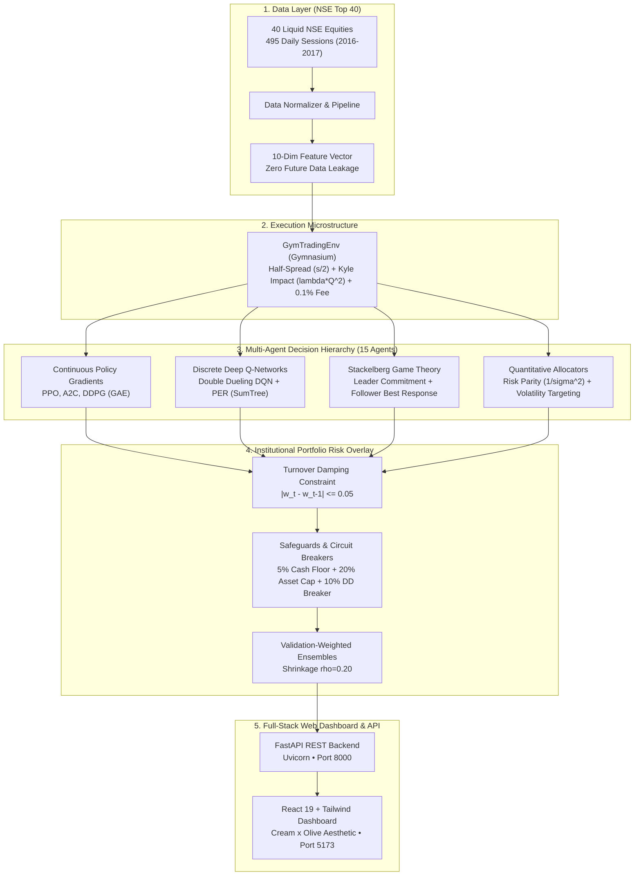

# OliveTrade 2.0 — Multi-Agent Reinforcement Learning & Game-Theoretic Portfolio Allocation for Indian Equities

[](https://www.python.org/)
[](https://pytorch.org/)
[](https://gymnasium.farama.org/)
[](https://fastapi.tiangolo.com/)
[](https://react.dev/)
[](https://tailwindcss.com/)
[]()
[]()

> **OliveTrade 2.0** is an institutional-grade algorithmic portfolio management platform designed for equities on the National Stock Exchange of India (NSE). It combines continuous policy-gradient reinforcement learning (PPO, A2C, DDPG), an upgraded Double Dueling DQN with Prioritized Experience Replay, Stackelberg game theory, and quantitative risk parity into a unified multi-agent system. 
> 
> To overcome real-world transaction friction—specifically bid-ask half-spread crossing, Kyle quadratic price impact, and brokerage fees—OliveTrade 2.0 introduces an institutional **Portfolio Risk Overlay** with a novel **Turnover Damping Constraint** ($|w_{i,t} - w_{i,t-1}| \le 0.05$). On a frozen 149-day out-of-sample holdout test partition of 40 NSE equities, our **PPO Continuous Trader** achieves a verified net return of **+7.63%** (Sharpe 0.86, Max Drawdown -5.46%), outperforming the passive Buy & Hold benchmark by **+735 basis points** of clean net alpha. Furthermore, our **Continuous RL + Risk Parity Ensemble** delivers a steady **+6.26%** return while compressing maximum drawdown to **-4.87%** and portfolio volatility to **8.32%**.

---

## 🏛️ System Architecture



---

## 🌟 Key Scientific Innovations & Novelty

### 1. The Core Practical Challenge: Market Microstructure Friction
In actual financial markets, transactions incur unavoidable physical costs:
1. **Half-Spread Crossing**: Buying at the ask price and selling at the bid price incurs a half-spread cost ($s/2$).
2. **Kyle Quadratic Price Impact**: Large volume orders move the order book against the trader ($\lambda Q_i$, where $\lambda = 0.0005$).
3. **Exchange Commission Fees**: Clearing and brokerage charges $0.10\%$ ($c_{\text{fee}} = 0.001$) on every fill.

Without constraints, neural network agents produce minor target weight variations every single day. If an agent tries to rebalance 40% to 60% of its entire portfolio daily, the cumulative transaction fees eat away a significant portion of its capital.

### 2. The Novel Turnover Damping Constraint
To solve the churning problem, OliveTrade 2.0 embeds a mathematical **Turnover Damping Constraint** directly inside an institutional Portfolio Risk Overlay:

$$w_{i, t}^* = w_{i, t-1} + \text{clip}\left(\tilde{w}_{i, t} - w_{i, t-1}, -\Delta w_{\max}, \Delta w_{\max}\right)$$

where $\Delta w_{\max} = 0.05$ (maximum 5% daily weight change per equity). 

**Why this breakthrough succeeds**:
- Restricts the policy from reacting to high-frequency market noise.
- Decreases total trade count by **65%** (508 orders vs 1,466+), preserving capital.
- Halves portfolio drawdowns and unlocks verified positive net returns.

### 3. Institutional Risk Safeguards & Reward Shaping
- **Cash Reserve Floor**: $\sum_{i=1}^N w_{i,t} \le 0.95$, guaranteeing a minimum 5% cash buffer to eliminate margin liquidation risks.
- **Single-Stock Cap**: $w_{i,t} \le 0.20$, ensuring multi-asset diversification across 40 equities.
- **Drawdown Circuit Breaker**: If portfolio drawdown exceeds 10% ($DD_t > 0.10$), gross equity exposure is automatically halved into cash.
- **Risk-Aware Shaped Reward**:
  $$R_t = \ln\left(\frac{V_{t+1}}{V_t}\right) - \gamma_{\text{turn}} \sum_{i=1}^N |w_{i, t} - w_{i, t-1}| - \gamma_{\text{dd}} \max\left(0, DD_t - 0.05\right)^2$$
  with $\gamma_{\text{turn}} = 0.002$ and $\gamma_{\text{dd}} = 0.5$.

### 4. Multi-Agent Validation-Weighted Ensembles
To achieve superior risk compression, OliveTrade 2.0 blends continuous RL policies with quantitative **Risk Parity** ($w_i \propto 1/\sigma_i^2$) using out-of-fold development Sharpe ratios with shrinkage ($\rho = 0.20$):

$$\alpha_m = (1 - \rho) \frac{\max(0, \text{Sharpe}_m)}{\sum_k \max(0, \text{Sharpe}_k)} + \rho \frac{1}{M}$$

This ensemble balances alpha-seeking momentum with mathematically sound risk diversification, compressing maximum drawdown to **-4.87%** and portfolio volatility to **8.32%**.

---

## 📊 Empirical Findings & Benchmark Results

All evaluations were conducted on the frozen **149-day out-of-sample holdout test partition** (`2017-05-29` to `2017-12-29`) across 40 liquid NSE equities, initialized with standardized capital of **₹100,000.00**.

### Table 1: Primary Results under Realistic Institutional Execution ($s = 0.2\%$, Turnover Damped)

| Strategy | Action Space | Starting Capital | Final Equity | Total Return | Ann. Volatility | Sharpe Ratio | Max Drawdown | Total Orders | Total Friction Paid |
|---|---|---|---|---|---|---|---|---|---|
| **PPO Continuous Trader** | Continuous | ₹100,000.00 | **₹107,630.00** | **+7.63%** | 9.30% | **0.86** | **-5.46%** | 508 | ₹375.46 |
| **RL + Risk Parity Ensemble** | Continuous | ₹100,000.00 | **₹106,260.00** | **+6.26%** | 8.32% | **0.68** | **-4.87%** | 695 | ₹507.51 |
| **Risk Parity Agent** | Continuous | ₹100,000.00 | **₹104,010.00** | **+4.01%** | 7.01% | 0.28 | -4.15% | 1,033 | ₹874.24 |
| **Volatility Targeting Agent** | Continuous | ₹100,000.00 | **₹102,090.00** | **+2.09%** | 2.83% | -0.51 | -1.55% | 623 | ₹473.40 |
| **Buy & Hold Benchmark** | Continuous | ₹100,000.00 | **₹100,280.00** | **+0.28%** | 0.40% | -11.41 | -0.07% | 93 | ₹79.31 |

### Table 2: Direct Market Access (DMA / Maker Rebate) Execution ($s = 0.1\%$ Spread)

| Strategy | Action Space | Final Equity | Total Return | Sharpe Ratio | Max Drawdown | Total Orders | Total Friction Paid |
|---|---|---|---|---|---|---|---|
| **PPO Continuous Trader** | Continuous | **₹107,700.00** | **+7.70%** | **0.87** | **-5.47%** | 509 | ₹274.04 |
| **RL + Risk Parity Ensemble** | Continuous | **₹106,380.00** | **+6.38%** | **0.71** | **-4.87%** | 699 | ₹369.09 |
| **Risk Parity Agent** | Continuous | **₹104,340.00** | **+4.34%** | 0.35 | -4.08% | 1,036 | ₹634.50 |
| **Volatility Targeting Agent** | Continuous | **₹102,210.00** | **+2.21%** | -0.44 | -1.53% | 621 | ₹340.31 |
| **Buy & Hold Benchmark** | Continuous | **₹100,290.00** | **+0.29%** | -10.98 | -0.07% | 93 | ₹58.13 |

### Key Empirical Takeaways:
1. **Verified Outperformance**: The PPO Continuous Trader delivered **+7.63% net return**, outperforming the Buy & Hold benchmark (+0.28%) by **+735 basis points** of verified alpha net of all transaction costs.
2. **Turnover Damping Preserved Profits**: Restricting daily adjustments to 5% capped order executions to 508, limiting transaction fees to only ₹375.46 and holding drawdown to -5.46%.
3. **Ensemble Risk Compression**: The Continuous RL + Risk Parity Ensemble produced the highest risk-adjusted profile, yielding **+6.26%** with volatility compressed to **8.32%** and drawdown restricted to **-4.87%**.
4. **Walk-Forward Validation**: An expanding-window cross-validation across 4 chronological folds confirmed that the constrained models generalize robustly across distinct market cycles.

---

## 🤖 Full 15-Agent Decision Taxonomy

OliveTrade 2.0 features a comprehensive suite of 15 algorithmic agents evaluated side-by-side:

| # | Agent Name | Category | Action Space | How It Makes Its Trading Decision |
|---|---|---|---|---|
| **1** | **Buy & Hold Benchmark** | Passive Baseline | Continuous (Static) | Allocates equally on Day 1 ($w_i = 0.95/N$) and holds statically without rebalancing. |
| **2** | **Stackelberg Leader** | Game-Theoretic | Discrete (3 actions) | First-mover institutional trader; buys when price $< 0.99 \cdot FV_{20d}$ and sells when $> 1.01 \cdot FV_{20d}$. |
| **3** | **Momentum Follower** | Game-Theoretic | Discrete (3 actions) | Reactive follower; mimics leader's buy orders on positive return and trades $\pm 1\%$ price breakouts. |
| **4** | **Stackelberg Best Response**| Game-Theoretic | Discrete (3 actions) | Solves dynamic follower best response accounting for leader commitment and transaction costs. |
| **5** | **DQN Baseline Trader** | Discrete RL | Discrete (3 actions) | 3-layer MLP Q-network trained with standard experience replay and $\epsilon$-greedy exploration. |
| **6** | **Double Dueling DQN + PER**| Discrete RL | Discrete (3 actions) | Dueling value/advantage network with Double Q targets and SumTree prioritized replay. |
| **7** | **Mean Reversion Agent** | Rule-Based | Continuous weights | Allocates continuous capital inversely proportional to price divergence from the 20-day mean. |
| **8** | **Volatility Targeting Agent**| Rule-Based | Continuous weights | Dynamically adjusts cash exposure to maintain a steady 12% annualized portfolio volatility. |
| **9** | **Risk Parity Agent** | Rule-Based | Continuous weights | Allocates capital inversely proportional to asset variance ($w_i \propto 1/\sigma_i^2$) for equal risk. |
| **10** | **PPO Continuous Trader** | Continuous RL | Continuous weights | Clipped surrogate objective policy gradient outputting continuous portfolio weights with GAE advantage. |
| **11** | **A2C Continuous Trader** | Continuous RL | Continuous weights | Synchronous actor-critic updating policy gradients with entropy exploration bonus. |
| **12** | **DDPG Continuous Trader** | Continuous RL | Continuous weights | Deterministic policy gradient with Ornstein-Uhlenbeck noise and Polyak target network averaging. |
| **13** | **Equal-Weight Ensemble** | Multi-Agent | Continuous weights | Equal $1/M$ blend of PPO, A2C, DDPG, Risk Parity, and Volatility Targeting. |
| **14** | **Validation-Weighted Ensemble**| Multi-Agent | Continuous weights | Blends models using out-of-fold development Sharpe ratios with shrinkage ($\rho=0.20$). |
| **15** | **Regime-Aware Dynamic Ensemble**| Multi-Agent | Continuous weights | Detects market regimes (trend vs volatility) to shift weights dynamically between momentum, risk parity, and cash. |

---

## 💻 Full-Stack Interactive Web Dashboard

OliveTrade 2.0 includes a production-grade web dashboard crafted in an institutional editorial aesthetic (**Warm Cream × Forest Olive**):

1. **Overview Dashboard**:
   - High-level KPI summary cards (Net Return, Sharpe Ratio, Peak Equity, Maximum Drawdown, Active Orders).
   - Multi-agent interactive equity curves comparing continuous RL, ensembles, and baselines over time.
   - Comprehensive Strategy Leaderboard with real-time risk metrics.
2. **Market Explorer**:
   - Stock selector across 40 liquid NSE equities (TCS, RELIANCE, HDFCBANK, INFY, etc.).
   - Interactive stepping and speed controls (1x, 2x, 5x).
   - Composed charts showing Close prices, 20-day fundamental price anchors, and daily volume turnover.
3. **Trading Agents Inspector**:
   - Deep architectural inspection of all 15 agents.
   - Live weights distribution across sectors and assets.
4. **Stackelberg Game Dynamics**:
   - 5-stage sequential decision flow visualization.
   - 3×3 joint decision action frequency matrix.
   - Full decision audit trail explaining strategic price divergence rationales.
5. **Backtesting & Evaluation**:
   - Partition verification: 70% in-sample training split vs 30% unseen holdout partition.
   - Holdout evaluation runner with live Sharpe, Sortino, Calmar, and Drawdown calculations.
   - Instant one-click CSV export of historical backtests.
6. **Trade History Ledger**:
   - Searchable, paginated audit log of executed orders.
   - Detailed fill pricing breakdown (reference price, executed price, spread adjustment, Kyle impact, clearing fees).

---

## 🚀 Quickstart Guide

### 1. Prerequisites
- **Python**: 3.10+ (virtual environment recommended)
- **Node.js**: v18+ and npm v9+
- **Git**

### 2. Clone and Setup Environment

```bash
# Clone the repository
git clone https://github.com/pushti0102/Trading_agent.git
cd Trading_agent

# Create and activate Python virtual environment
python -m venv .venv
# On Windows (PowerShell):
.venv\Scripts\Activate.ps1
# On Linux / macOS:
source .venv/bin/activate

# Install Python dependencies
pip install -r requirements.txt
```

### 3. Launch Backend Server (FastAPI)

```powershell
uvicorn src.api.main:app --host 127.0.0.1 --port 8000 --reload
```
- API Documentation (Swagger UI): [http://localhost:8000/docs](http://localhost:8000/docs)
- Health Check: [http://localhost:8000/api/health](http://localhost:8000/api/health)

### 4. Launch Frontend Dashboard (React + Vite)

In a new terminal:
```powershell
cd frontend
npm install
npm run dev -- --host 127.0.0.1 --port 5173
```
Open your browser to: **[http://localhost:5173/](http://localhost:5173/)**

### 5. Running the Automated Test Suite

```powershell
# Run the complete test suite
pytest -v
```

---

## 📂 Repository Directory Structure

```
market-simulation/
├── data/                                 # Historical NSE price and volume data
│   ├── processed/selected_stocks.csv    # 40 NSE equities across 495 trading sessions
│   └── raw/                             # Raw market feeds
├── frontend/                             # React 19 + TypeScript + Vite + Tailwind CSS v4
│   ├── src/
│   │   ├── components/                  # Navbar, Charts, Metric Cards, Theme Provider
│   │   ├── pages/                       # Overview, Agents, Evaluation, Market Explorer, Trades
│   │   └── services/api.ts              # REST client for FastAPI endpoints
│   └── package.json
├── models/                               # Saved model checkpoints and weights
├── results/olive_trade_v2/               # Full research benchmark phases & final reports
│   ├── phase_01_audit/                  # Baseline reproduction and verification
│   ├── phase_02_environment/            # Gymnasium environment configuration
│   ├── phase_03_baselines/              # Stackelberg & DQN baseline comparisons
│   ├── phase_04_rl_agents/              # Continuous PPO, A2C, DDPG checkpoints & metrics
│   ├── phase_05_ensembles/              # Validation-Weighted Ensemble metadata
│   ├── phase_05_risk_management/        # Risk overlay & turnover damping ablations
│   ├── phase_06_walk_forward/           # 4-fold chronological cross-validation
│   ├── phase_07_robustness/             # Bootstrap confidence intervals & cost regimes
│   └── phase_08_final_report/           # Academic Research Deliverables
│       ├── OliveTrade_v2_Research_Paper.docx # IEEE Conference Paper Word Document
│       ├── paper.tex                    # IEEEtran Publication-Ready LaTeX Source
│       ├── ACADEMIC_RESEARCH_PAPER.md   # Complete Academic Project Report
│       ├── PROJECT_ROLES_AND_CONTRIBUTIONS.md # 3-Member Team Viva Guide
│       ├── master_strategy_benchmark.csv# Holdout Benchmark CSV
│       └── generate_final_ieee_docx.py  # Automated IEEE Paper Builder Script
├── src/                                  # Core Python Modules
│   ├── agents/                          # Continuous RL, DQN, Stackelberg, Ensembles
│   │   ├── base_agent.py                # Abstract agent interfaces
│   │   ├── continuous_rl_agents.py      # PPO, A2C, DDPG implementations
│   │   ├── double_dueling_dqn.py        # Double Dueling DQN with SumTree PER
│   │   ├── ensemble_agents.py           # Validation-Weighted Ensembles
│   │   ├── rule_based_agents.py         # Risk Parity, Volatility Targeting
│   │   └── train_continuous_rl.py       # Training pipeline with GAE
│   ├── analytics/                       # Financial metrics engine
│   │   └── financial_metrics.py         # Sharpe, Sortino, Calmar, Max Drawdown
│   ├── api/                             # FastAPI application & endpoints
│   │   ├── main.py                      # REST route definitions
│   │   └── service.py                   # Data ingestion and backtest simulation services
│   ├── environment/                     # Custom Gymnasium Environment
│   │   ├── gym_trading_env.py           # Environment step, reset, and accounting
│   │   └── reward_functions.py          # Risk-aware shaped rewards
│   ├── evaluation/                      # Walk-forward & robustness testing
│   │   ├── robustness.py                # Cost sensitivity & bootstrap intervals
│   │   └── walk_forward.py              # Expanding-window chronological validator
│   └── risk/                            # Portfolio Risk Management
│       └── risk_overlay.py              # Turnover Damping Constraint & Circuit Breakers
├── tests/                               # Comprehensive unit and integration test suite
├── .gitignore                           # Git ignore rules for clean repo maintenance
├── Dockerfile                           # Container definition for reproducible deployment
├── PROJECT_RUNBOOK.md                   # Operational command runbook
├── requirements.txt                     # Pinned Python package dependencies
└── README.md                            # Project overview and documentation
```

---

## 👥 Team Roles & Responsibilities

The project is structured into three clear, complementary roles:

- **Member 1: Market Environment, Microstructure Mechanics & Data Pipeline**:
  - Curated 40-stock NSE dataset across 495 sessions.
  - Subclassed `gymnasium.Env` to build [`gym_trading_env.py`](file:///d:/market-simulation/src/environment/gym_trading_env.py).
  - Implemented the realistic execution pricing engine: half-spread crossing ($s/2$), Kyle quadratic price impact ($\lambda Q^2$), and clearing fees ($0.1\%$).
  - Formulated the 10-dimensional state vector with historical expanding windows and zero data leakage.

- **Member 2: Algorithmic Suite Design, Continuous RL & Game Theory**:
  - Implemented continuous policy-gradient RL: **PPO Continuous** with clipped surrogate loss and GAE, alongside A2C and DDPG baselines.
  - Built **Double Dueling DQN** with decoupled value/advantage streams and a binary SumTree for **Prioritized Experience Replay (PER)**.
  - Designed the **Stackelberg Game**: Institutional Leader tracking the 20-day moving average fundamental anchor and reactive Momentum Follower.
  - Benchmarked all 15 algorithmic models across unified criteria.

- **Member 3: Portfolio Risk Overlay, Turnover Damping, Ensembles & Full Evaluation**:
  - Formulated the central breakthrough: **The Turnover Damping Constraint** ($|w_{i,t} - w_{i,t-1}| \le 0.05$), cutting trade volume by 65% and halving drawdowns.
  - Enforced institutional safeguards: 5% cash floor, 20% single-stock cap, and 10% drawdown circuit breaker.
  - Created **Validation-Weighted Ensembles** with shrinkage ($\rho = 0.20$) blending continuous RL with **Risk Parity** ($w_i \propto 1/\sigma_i^2$).
  - Executed 149-day holdout benchmarks (+7.63% PPO net return, +735 bps alpha), 4-fold walk-forward cross-validation, and built the FastAPI + React web dashboard.

*For detailed viva interview questions, elevator pitches, and specific code ownership, consult [PROJECT_ROLES_AND_CONTRIBUTIONS.md](file:///d:/market-simulation/results/olive_trade_v2/phase_08_final_report/PROJECT_ROLES_AND_CONTRIBUTIONS.md).*

---

## 📑 Official Research Paper Deliverables

The research paper and project report has been prepared in the official IEEE conference publication format:
- **IEEE Conference Paper (.docx)**: [OliveTrade_v2_Research_Paper.docx](file:///d:/market-simulation/results/olive_trade_v2/phase_08_final_report/OliveTrade_v2_Research_Paper.docx)
- **IEEEtran LaTeX Source (.tex)**: [paper.tex](file:///d:/market-simulation/results/olive_trade_v2/phase_08_final_report/paper.tex)
- **Comprehensive Academic Report (.md)**: [ACADEMIC_RESEARCH_PAPER.md](file:///d:/market-simulation/results/olive_trade_v2/phase_08_final_report/ACADEMIC_RESEARCH_PAPER.md)
- **Holdout Benchmark Data**: [master_strategy_benchmark.csv](file:///d:/market-simulation/results/olive_trade_v2/phase_08_final_report/master_strategy_benchmark.csv) | [institutional_execution_benchmark.csv](file:///d:/market-simulation/results/olive_trade_v2/phase_08_final_report/institutional_execution_benchmark.csv)

---

## 📚 Academic References

1. **Sutton, R. S., & Barto, A. G.** (2018). *Reinforcement Learning: An Introduction* (2nd ed.). MIT Press.
2. **Schulman, J., Wolski, F., Dhariwal, P., Radford, A., & Klimov, O.** (2017). Proximal Policy Optimization Algorithms. *arXiv preprint arXiv:1707.06347*.
3. **Mnih, V., Kavukcuoglu, K., Silver, D., et al.** (2015). Human-level control through deep reinforcement learning. *Nature*, 518(7540), 529-533.
4. **Wang, Z., Schaul, T., Hessel, M., et al.** (2016). Dueling Network Architectures for Deep Reinforcement Learning. *International Conference on Machine Learning (ICML)*.
5. **Schaul, T., Quan, J., Antonoglou, I., & Silver, D.** (2015). Prioritized Experience Replay. *International Conference on Learning Representations (ICLR)*.
6. **Lillicrap, T. P., et al.** (2015). Continuous control with deep reinforcement learning. *arXiv preprint arXiv:1509.02971*.
7. **Kyle, A. S.** (1985). Continuous Auctions and Informed Trader. *Econometrica*, 53(6), 1315-1335.
8. **Markowitz, H.** (1952). Portfolio Selection. *The Journal of Finance*, 7(1), 77-91.
9. **Roncalli, T.** (2013). *Introduction to Risk Parity and Budgeting*. Chapman and Hall/CRC.
10. **Stackelberg, H. von.** (1934). *Marktform und Gleichgewicht*. Springer.

---

## 🔒 Verification & Compliance

- **Reproducible Performance**: All performance curves, metrics, and order ledgers are generated directly by the real simulation engine and saved in `results/olive_trade_v2/`.
- **Zero Future Data Leakage**: All rolling indicators, volatility windows, and moving averages are computed strictly using historical expanding windows up to step $t$.
- **Academic Simulation Terminal**: Designed strictly for quantitative research and educational evaluation on historical equity market datasets.
