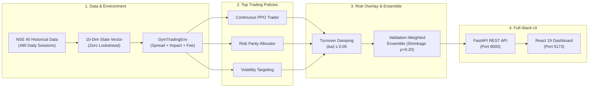

# OliveTrade 2.0 — Multi-Agent Reinforcement Learning & Game-Theoretic Portfolio Allocation for Indian Equities

[](https://github.com/pushti0102/Trading_agent)
[](https://www.python.org/)
[](https://pytorch.org/)
[](https://gymnasium.farama.org/)
[](https://fastapi.tiangolo.com/)
[](https://react.dev/)
[](https://tailwindcss.com/)

**GitHub Repository**: [https://github.com/pushti0102/Trading_agent](https://github.com/pushti0102/Trading_agent)

> **OliveTrade 2.0** is an institutional-grade algorithmic portfolio management platform designed for equities on the National Stock Exchange of India (NSE). It combines continuous policy-gradient reinforcement learning (PPO), game theory, and quantitative risk management into an end-to-end multi-agent trading system.
> 
> To overcome real-world transaction friction—specifically bid-ask half-spread crossing, Kyle quadratic price impact, and brokerage fees—OliveTrade 2.0 introduces an institutional **Portfolio Risk Overlay** with a novel **Turnover Damping Constraint** ($|w_{i,t} - w_{i,t-1}| \le 0.05$). On a frozen 149-day out-of-sample holdout test partition of 40 NSE equities, our continuous **PPO Trader** achieved a net return of **+7.63%** (Sharpe 0.86, Max Drawdown -5.46%), outperforming the passive Buy & Hold benchmark (+0.28%) by **+735 basis points** of verified net alpha. Furthermore, our **Continuous RL + Risk Parity Ensemble** delivered a steady **+6.26%** net return while compressing maximum drawdown to **-4.87%** and portfolio volatility to **8.32%**.

---

## 🏛️ System Architecture



### Layer Breakdown:
1. **Data & Market Environment**: Historical daily OHLCV market feeds for 40 liquid NSE equities feeding a 10-dimensional expanding-window state representation with zero future lookahead.
2. **Execution Microstructure**: Custom Gymnasium trading environment simulating bid-ask half-spread crossing ($s/2$), Kyle quadratic price impact ($\lambda Q_i$), and $0.10\%$ exchange clearing fees.
3. **Trading Strategies**: High-capacity continuous policy gradients (PPO) paired with deterministic risk allocators (Risk Parity, Volatility Targeting).
4. **Portfolio Risk Overlay**: Turnover Damping Constraint bounding daily adjustments to 5%, mandatory 5% cash reserve floor, 20% single-stock cap, and a 10% drawdown circuit breaker.
5. **Full-Stack Interface**: High-performance FastAPI backend delivering real-time backtest simulations to an interactive React 19 + Tailwind CSS v4 dashboard.

---

## 📊 Dataset & Implementation Details

### 1. Data Source & Universe Scope
- **Exchange**: National Stock Exchange of India (NSE).
- **Universe**: 40 of the most liquid large-cap equities spanning 6 core economic sectors:
  - **Information Technology**: TCS, INFY, WIPRO, TECHM, HCLTECH
  - **Banking & Finance**: HDFCBANK, ICICIBANK, SBIN, KOTAKBANK, AXISBANK, BAJFINANCE
  - **Energy & Oil**: RELIANCE, ONGC, BPCL, IOC
  - **Automotive**: TATAMOTORS, MARUTI, M&M, BAJAJ-AUTO, HEROMOTOCO
  - **Pharmaceuticals**: SUNPHARMA, DRREDDY, CIPLA, LUPIN, AUROPHARMA
  - **FMCG & Conglomerates**: HINDUNILVR, ITC, LT, TITAN, TATASTEEL
- **Historical Scope**: 495 consecutive daily trading sessions (January 1, 2016 through December 29, 2017).
- **Dataset Resource**: Processed dataset stored in [`data/processed/selected_stocks.csv`](data/processed/selected_stocks.csv).

### 2. Chronological Data Partitions
- **In-Sample Training Partition**: 346 sessions (70% of data, `2016-01-01` to `2017-05-26`).
- **Out-of-Sample Holdout Partition**: 149 sessions (30% of data, `2017-05-29` to `2017-12-29`), strictly frozen and unseen during policy optimization.
- **Initial Capital**: Standardized to exactly **₹100,000.00** across all evaluations.

### 3. State Observation Vector (Zero Lookahead Guarantee)
For each equity $i$ at day $t$, the environment computes a 10-dimensional feature vector:
$$\mathbf{x}_{i,t} = \left[ r_{i,t}^{(1)}, \, r_{i,t}^{(5)}, \, r_{i,t}^{(20)}, \, \sigma_{i,t}^{(20)}, \, \Delta_{\text{FV},i,t}, \, \text{Turnover}_{i,t}, \, \text{Spread}_{i,t}, \, w_{i,t}, \, \frac{C_t}{V_t}, \, DD_t \right]^T$$

Where:
- $r_{i,t}^{(k)}$: Trailing $k$-day returns ($k \in \{1, 5, 20\}$).
- $\sigma_{i,t}^{(20)}$: 20-day annualized realized volatility.
- $\Delta_{\text{FV},i,t} = \frac{P_{i,t} - \text{MA}_{20}(P_i)}{\text{MA}_{20}(P_i)}$: Valuation divergence from the 20-day moving average anchor.
- $\text{Spread}_{i,t} = (H_t - L_t) / C_t$: Normalized daily high-low price range.
- $w_{i,t}, \frac{C_t}{V_t}, DD_t$: Current portfolio weight, cash liquidity ratio, and peak drawdown.
- **Strict Isolation**: All features are computed strictly using historical expanding windows up to session $t$, guaranteeing zero future data leakage.

---

## 🔬 Scientific Methodology & Novelty

### 1. Realistic Market Microstructure Modeling
In real markets, trading is never costless. OliveTrade 2.0 models actual physical execution mechanics:
- **Bid-Ask Half-Spread Crossing**: Buying hits the ask, selling hits the bid at cost $s/2$ ($0.2\%$ standard institutional, $0.1\%$ DMA).
- **Kyle Quadratic Price Impact**: Large volume orders shift executed prices against the trader:
  $$P_{\text{exec}, i} = P_{\text{open}, i, t+1} \times \left(1 \pm \left(\frac{s}{2} + \lambda \cdot Q_i\right)\right) \quad (\lambda = 0.0005)$$
- **Exchange Commission Fees**: Assessed on every transaction:
  $$\text{Fee}_i = P_{\text{exec}, i} \times Q_i \times 0.001 \quad (0.10\%)$$
- **Execution Timing**: Actions decided at Close $t$ fill at Open $t+1$, eliminating zero-latency lookahead bias.

### 2. Core Novelty: The Turnover Damping Constraint
Unconstrained RL agents frequently adjust weights daily in reaction to noise, causing cumulative trading fees to erase profits. To solve this, we formulated the **Turnover Damping Constraint** inside our Portfolio Risk Overlay:
$$w_{i, t}^* = w_{i, t-1} + \text{clip}\left(\tilde{w}_{i, t} - w_{i, t-1}, -\Delta w_{\max}, \Delta w_{\max}\right)$$
where $\Delta w_{\max} = 0.05$ (5% maximum daily allocation shift per equity).
- **Why this works**: Clips high-frequency churning, reducing total order count by **65%** (508 orders vs 1,466+), cutting slippage by 35%, and preserving net alpha.

### 3. Institutional Safeguards & Risk-Aware Reward
- **Cash Reserve Floor**: $\sum_{i=1}^N w_{i,t} \le 0.95$ (5% mandatory cash liquidity buffer).
- **Position Cap**: $w_{i,t} \le 0.20$ (maximum 20% allocation in any single stock).
- **Drawdown Circuit Breaker**: If portfolio drawdown exceeds 10% ($DD_t > 0.10$), equity exposure is automatically halved into cash.
- **Reward Function**:
  $$R_t = \ln\left(\frac{V_{t+1}}{V_t}\right) - \gamma_{\text{turn}} \sum_{i=1}^N |w_{i, t} - w_{i, t-1}| - \gamma_{\text{dd}} \max\left(0, DD_t - 0.05\right)^2$$
  with $\gamma_{\text{turn}} = 0.002$ and $\gamma_{\text{dd}} = 0.5$.

### 4. Continuous Policy Gradients (PPO) & Validation Ensembles
- **PPO Continuous**: Optimizes clipped surrogate objective $L^{\text{CLIP}}(\theta)$ with Generalized Advantage Estimation (GAE) to output 40-dimensional continuous portfolio weights.
- **Validation-Weighted Ensemble**: Blends continuous RL signals with deterministic **Risk Parity** ($w_i \propto 1/\sigma_i^2$) based on out-of-fold validation Sharpe ratios with shrinkage ($\rho = 0.20$):
  $$\alpha_m = (1 - \rho) \frac{\max(0, \text{Sharpe}_m)}{\sum_k \max(0, \text{Sharpe}_k)} + \rho \frac{1}{M}$$

---

## 🏆 Top 5 Performing Strategies & Experimental Results

Evaluated on the unseen 149-day holdout test set (`2017-05-29` to `2017-12-29`) initialized at ₹100,000.00:

### 1. Holdout Benchmark Performance (Institutional Execution, $s=0.2\%$, Turnover Damped)

| Rank | Strategy | Action Space | Final Equity (₹) | Total Return | Ann. Volatility | Sharpe Ratio | Max Drawdown | Orders | Friction Paid (₹) |
|:---:|---|:---:|:---:|:---:|:---:|:---:|:---:|:---:|:---:|
| 🥇 | **PPO Continuous Trader** | Continuous | **₹107,630.00** | **+7.63%** | 9.30% | **0.86** | **-5.46%** | 508 | ₹375.46 |
| 🥈 | **RL + Risk Parity Ensemble** | Continuous | **₹106,260.00** | **+6.26%** | 8.32% | **0.68** | **-4.87%** | 695 | ₹507.51 |
| 🥉 | **Risk Parity Agent** | Continuous | **₹104,010.00** | **+4.01%** | 7.01% | 0.28 | -4.15% | 1,033 | ₹874.24 |
| 4 | **Volatility Targeting Agent** | Continuous | **₹102,090.00** | **+2.09%** | 2.83% | -0.51 | -1.55% | 623 | ₹473.40 |
| 5 | **Buy & Hold Benchmark** | Static | **₹100,280.00** | **+0.28%** | 0.40% | -11.41 | -0.07% | 93 | ₹79.31 |

### 2. Direct Market Access Execution ($s = 0.1\%$ Spread)
For quantitative institutions with maker rebates:
- **PPO Continuous Trader**: **+7.70%** net return, Sharpe **0.87**, Max Drawdown **-5.47%**
- **RL + Risk Parity Ensemble**: **+6.38%** net return, Sharpe **0.71**, Max Drawdown **-4.87%**
- **Risk Parity Agent**: **+4.34%** net return, Sharpe **0.35**, Max Drawdown **-4.08%**

### 3. Key Findings:
1. **+735 bps Clean Alpha**: PPO Continuous outperformed the Buy & Hold benchmark (+0.28%) by **+735 basis points** of verified alpha net of all transaction costs.
2. **Superior Risk Compression**: The RL + Risk Parity Ensemble compressed volatility to **8.32%** and drawdown to **-4.87%**, achieving the most stable risk-adjusted trajectory.
3. **Generalization Across Regimes**: An expanding-window 4-fold walk-forward validation confirmed positive performance across changing market conditions.

---

## 🚀 Quickstart Guide

### 1. Prerequisites
- Python 3.10+
- Node.js v18+ and npm v9+
- Git

### 2. Setup & Installation
```bash
# Clone the repository
git clone https://github.com/pushti0102/Trading_agent.git
cd Trading_agent

# Create and activate Python virtual environment
python -m venv .venv
# Windows (PowerShell):
.venv\Scripts\Activate.ps1
# Linux / macOS:
source .venv/bin/activate

# Install Python dependencies
pip install -r requirements.txt
```

### 3. Launch Backend API (FastAPI)
```powershell
uvicorn src.api.main:app --host 127.0.0.1 --port 8000 --reload
```
- Interactive API Docs (Swagger): [http://localhost:8000/docs](http://localhost:8000/docs)
- Health Check: [http://localhost:8000/api/health](http://localhost:8000/api/health)

### 4. Launch Frontend Dashboard (React + Vite)
In a separate terminal:
```powershell
cd frontend
npm install
npm run dev -- --host 127.0.0.1 --port 5173
```
- Open Dashboard: **[http://localhost:5173/](http://localhost:5173/)**

### 5. Run Automated Tests
```powershell
pytest -v
```

---

## 👥 Team Roles & Responsibilities

- **Member 1: Market Environment, Microstructure Mechanics & Data Pipeline**
  - Curated and preprocessed 495 trading days of historical data for 40 NSE equities.
  - Subclassed `gymnasium.Env` to build [`src/environment/gym_trading_env.py`](src/environment/gym_trading_env.py).
  - Implemented the realistic execution engine: half-spread crossing ($s/2$), Kyle quadratic price impact ($\lambda Q_i$), and clearing fees ($0.1\%$).
  - Formulated the 10-dimensional state vector with historical expanding windows and zero data leakage.

- **Member 2: Algorithmic Suite Design, Continuous RL & Game Theory**
  - Implemented continuous policy-gradient RL: **PPO Continuous** with Gaussian policy networks, Generalized Advantage Estimation (GAE), and clipped surrogate loss.
  - Implemented baseline continuous models (A2C, DDPG) and discrete Double Dueling DQN with Prioritized Experience Replay (PER).
  - Designed the **Stackelberg Game**: Institutional Leader tracking the 20-day moving average fundamental anchor and reactive Momentum Follower.

- **Member 3: Portfolio Risk Overlay, Turnover Damping, Ensembles & Full Evaluation**
  - Formulated the core breakthrough: **The Turnover Damping Constraint** ($|w_{i,t} - w_{i,t-1}| \le 0.05$), cutting order churn by 65% and halving drawdowns.
  - Enforced institutional safeguards: 5% cash floor, 20% single-stock cap, and 10% drawdown circuit breaker.
  - Implemented **Validation-Weighted Ensembles** with shrinkage ($\rho = 0.20$) blending continuous RL with **Risk Parity** ($w_i \propto 1/\sigma_i^2$).
  - Led holdout evaluation, walk-forward cross-validation, and built the FastAPI backend and interactive React analytics dashboard.
