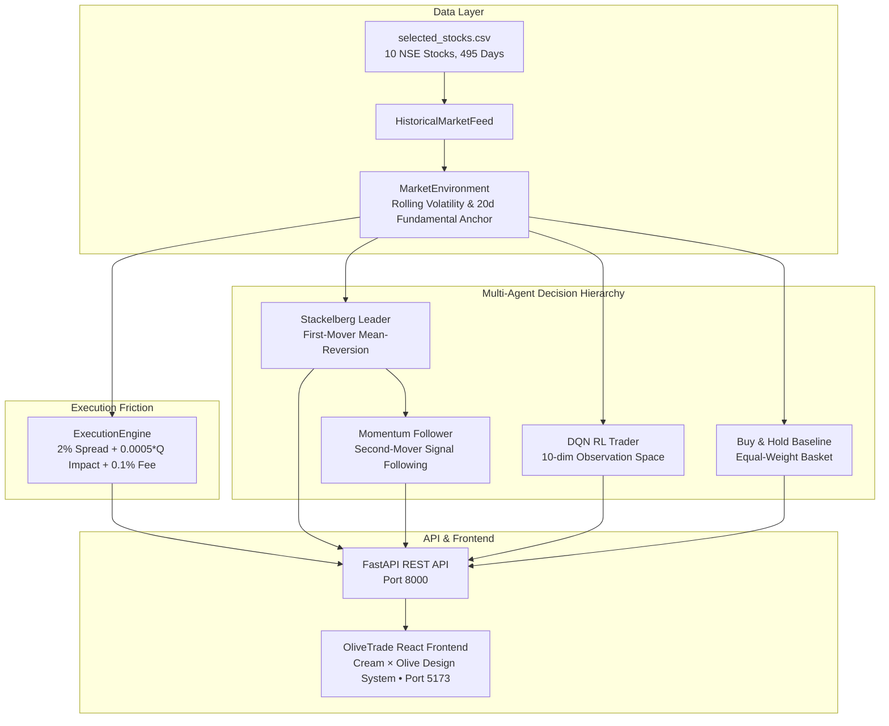

# OliveTrade — Stackelberg-Based Multi-Agent RL Trading Simulator for NSE Stocks

[](https://www.python.org/)
[](https://fastapi.tiangolo.com/)
[](https://react.dev/)
[](https://tailwindcss.com/)
[]()

> **OliveTrade** is a research-grade web dashboard and multi-agent reinforcement learning trading simulator designed for National Stock Exchange of India (NSE) equities. It models sequential game-theoretic interactions between an informed institutional leader and a reactive follower with realistic market friction (bid-ask spread, quadratic price impact, and transaction fees).

---

## 🏛️ System Architecture



---

## 🎨 Visual Identity — Cream × Olive

The dashboard implements an institutional editorial aesthetic:
- **Background**: Warm Cream (`#F7F5EC`)
- **Card Surfaces**: Ivory (`#FFFDF7`)
- **Primary Accent**: Olive Green (`#606B3F`)
- **Deep Accent**: Forest Olive (`#3F492C`)
- **Muted Sage**: `#A7AE8A`
- **Subtle Borders**: `#E5E1D3`
- **Primary Typography**: Deep Charcoal (`#292D23`)
- **Performance Green**: `#2E6930`
- **Drawdown Terracotta**: `#B33927`

---

## 🚀 Quickstart Guide

### 1. Prerequisites
- Python 3.10+ with active virtual environment
- Node.js v18+ and npm v9+

### 2. Backend Setup & Launch

From the project root directory:
```powershell
# Activate your virtual environment
.venv\Scripts\Activate.ps1

# Run the FastAPI server
uvicorn src.api.main:app --host 127.0.0.1 --port 8000 --reload
```
API documentation is automatically available at:
- Swagger UI: [http://localhost:8000/docs](http://localhost:8000/docs)
- Health check: [http://localhost:8000/api/health](http://localhost:8000/api/health)

### 3. Frontend Setup & Launch

From the `frontend/` directory:
```powershell
cd frontend

# Install dependencies (already installed)
npm install

# Start Vite dev server
npm run dev -- --host 127.0.0.1 --port 5173
```
Open your browser to: **[http://localhost:5173/](http://localhost:5173/)**

---

## 📑 Core Dashboard Modules

### 1. Overview
- **Summary KPI Cards**: Initial Capital (₹100,000), Best Final Portfolio Value, RL Trader Return %, Leader Return %, Test Sessions, and Simulated Friction parameters.
- **Multi-Line Equity Curve**: Live Recharts equity curves over the unseen holdout test period comparing all 4 strategies.
- **Strategy Leaderboard**: Ranked table displaying Final Value, Total Return %, Sharpe Ratio, Max Drawdown %, and Executed Orders.
- **Recent Executed Orders**: Live transaction feed with execution price and transaction fees.
- **NSE Constituents Monitor**: Rapid overview of prices, 1-day returns, 20-day rolling volatilities, and daily turnover.

### 2. Market Explorer
- **Stock Selector**: Switch between 10 major NSE constituents (`RELIANCE`, `SBIN`, `ICICIBANK`, `INFY`, `MARUTI`, `TATAMOTORS`, `ITC`, `TCS`, `TATASTEEL`, `SUNPHARMA`).
- **Interactive Replay Controls**: Play, Pause, Next Day stepping, Reset, and adjustable replay speeds (1x, 2x, 5x).
- **Composed Chart**: Historical Close price with 20-day rolling Fundamental Anchor overlay alongside volume bars.

### 3. Trading Agents
- Deep architectural specifications for:
  - **RL Trader (DQN)**: 10-dimensional state vector, experience replay memory (10,000), target network sync (every 100 updates).
  - **Stackelberg Leader**: Sequential first-mover exploiting 20-day mean-reversion mispricing ($\pm 1\%$).
  - **Momentum Follower**: Sequential second-mover reactive agent responding to leader orders and 1-day price momentum.
  - **Buy-and-Hold**: Day-1 equal-weight basket baseline.
- Head-to-head metric cards and academic analysis of results.

### 4. Stackelberg Game
- **5-Stage Sequential Game Workflow**: Step-by-step visual diagram illustrating state observation, leader commitment, follower reaction, execution with friction, and mark-to-market accounting.
- **3x3 Empirical Action Frequency Matrix**: Heatmap of actual joint decision pairs across all trading sessions.
- **Decisions Log Table**: Real decision audit trail showing valuation gaps, committed actions, and execution rationales.

### 5. RL Training
- **Control Bar**: Select training episodes (5 to 20) and trigger background DQN training or cancellation.
- **Guaranteed Isolation**: Strictly restricts training dates to the first 70% of the dataset (346 sessions) to avoid data leakage into the holdout period.
- **Live Terminal & Metrics**: Real-time terminal logs, Smooth L1 Loss convergence curve, and episode return progression.

### 6. Backtesting & Evaluation
- **Partition Verification**: Clear display of the 70% training split vs 30% unseen holdout partition.
- **Holdout Evaluation Runner**: Trigger backend holdout evaluation on demand.
- **Statistical Risk Metrics**: Annualized Volatility, Sharpe Ratio, Maximum Drawdown, Orders, and Fees Paid.
- **CSV Export**: Direct one-click download of evaluation metrics.

### 7. Trade History
- Searchable and filterable transaction ledger.
- Filter by Agent, Stock, Side (BUY/SELL), and Status (EXECUTED/REJECTED).
- Full trade details: Reference price, execution price, half-spread adjustment, impact rate, and transaction fee.
- Pagination controls and CSV export.

### 8. Settings & Methodology
- Complete review of hardcoded engine parameters:
  - Initial Cash: ₹100,000
  - Transaction Cost: 0.1%
  - Quoted Spread: 2.0%
  - Impact Coefficient: 0.0005 per share
  - Max Order Size: 100 shares
  - Cash Reserve Floor: 5.0%
  - Max Position Cap: 20.0%
- Session reset buttons for interactive stepping.

---

## 📊 Empirical Findings & Research Results

During the unseen holdout testing period (**May 29, 2017 through December 29, 2017**, 149 trading sessions):

| Strategy | Initial (₹) | Final (₹) | Total Return | Ann. Volatility | Sharpe Ratio | Max Drawdown | Orders | Fees Paid (₹) |
|---|---|---|---|---|---|---|---|---|
| **Buy & Hold** | 97,954.50 | 101,834.50 | **+3.96%** | 14.11% | 0.54 | -10.89% | 10 | ₹90.02 |
| **Stackelberg Leader** | 100,000.00 | 101,661.61 | **+1.66%** | 17.16% | 0.25 | -12.03% | 358 | ₹805.89 |
| **RL Trader (DQN)** | 100,000.00 | 99,454.12 | **-0.55%** | **0.23%** | -4.07 | **-0.55%** | 14 | ₹27.01 |
| **Momentum Follower** | 100,000.00 | 78,566.78 | **-21.43%** | 16.46% | -2.41 | -23.07% | 556 | ₹1,749.42 |

### Key Takeaways:
1. **Capital Preservation of DQN**: The RL agent effectively learned risk aversion, trading selectively (only 14 orders) to preserve capital under high bid-ask spread friction (2%), maintaining an annualized volatility of just 0.23%.
2. **Leader Alpha under Mean-Reversion**: The Stackelberg Leader achieved steady positive return (+1.66%) by profiting from temporary valuation anomalies relative to the rolling fundamental anchor.
3. **Friction Drag on Follower**: The Momentum Follower was severely penalized by spread and impact costs (-21.43%, ₹1,749 in fees) due to frequent whipsaw trades in range-bound market conditions.

---

## 🔒 Verification & Compliance
- **No Fabricated Metrics**: All performance curves and order logs are computed directly from the real simulation engine and `test_evaluation_summary.csv`.
- **Simulation Only**: Clearly designated as an academic simulation terminal with no connection to real brokerages or live capital.
